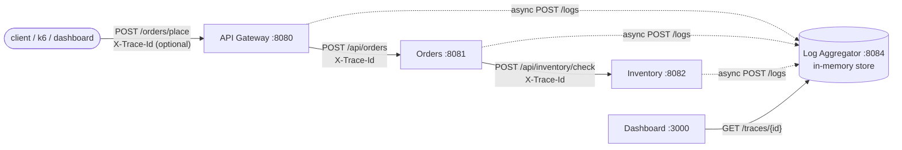

# Request Tracer

[](https://github.com/ttarkhani/request-tracer/actions/workflows/ci.yml)

A small, from-scratch distributed-tracing system, a scoped-down way to learn what Jaeger or Zipkin do under the hood.
A correlation ID (`X-Trace-Id`) propagates through three Spring Boot services (Gateway → Orders → Inventory). Each of
them ships two timestamped log entries per request (received / completed) to a central log aggregator, which stores
them by trace ID. A React dashboard renders a trace as a waterfall. The aggregator only stores logs; it doesn't
propagate IDs.

Every measured number in this README is copied from [`bench/RESULTS.md`](bench/RESULTS.md), which names the command and
raw-output file behind each one. The session log is in [`bench/WORKLOG.md`](bench/WORKLOG.md).

## Architecture



## Features

- **Trace ID at the entry point.** The Gateway honors an inbound `X-Trace-Id` only if it is a canonical
  8-4-4-4-12 hex UUID (upper case is normalized to lower case); anything else, including a missing header, gets a fresh
  `UUID.randomUUID()`. The ID is forwarded to Orders and always returned in an `X-Trace-Id` response header, which CORS
  exposes so a browser can read it. If Orders answers with an error status, the Gateway passes that status and body through. If Orders
  is unreachable, the Gateway returns 502. Both responses still carry the header.
- **Propagation.** Orders forwards the inbound ID unchanged to Inventory. If Orders or Inventory receives no
  `X-Trace-Id` or a blank one, that hop starts a new trace with a fresh UUID (Orders forwards it downstream). A null or
  blank trace ID is never shipped.
- **Asynchronous, bounded log shipping** (`LogShipper`, one copy per service, since services share no code):
  - `ship()` never blocks the request: it offers the entry to an `ArrayBlockingQueue` (capacity 10,000) and returns.
  - Overflow policy: **drop the newest** entry (the one being offered), counted as `dropped`.
  - Two daemon worker threads POST entries with their own `RestTemplate`: 500 ms connect and 2 s read timeouts.
    There are no retries. A failed POST is counted as `failed`.
  - Micrometer counter `log.shipper.events` with tag `outcome` = `enqueued | shipped | dropped | failed`, and gauge
    `log.shipper.queue.depth`. Every entry handed to `ship()` counts as `enqueued`, so once the queue drains,
    `enqueued = shipped + dropped + failed`. Actuator exposes only `health` and `metrics`.
  - On shutdown it stops accepting, drains for at most 3 s (`flush-timeout-ms`), and counts anything left as `dropped`.
  - Timestamps are captured when the event happens (request received / response received), not when the entry is sent.
  - Settings live under `log.shipper.*` in each service's `application.yml`.
- **Aggregator.** Entries live in a `ConcurrentHashMap<traceId, CopyOnWriteArrayList>`. `POST /logs` rejects a
  null/blank/missing `traceId` with 400. `GET /traces/{id}` returns entries sorted by timestamp (ties keep arrival order).
  `GET /stats` returns trace and entry counts, which the load test uses for its no-loss check.
- **Startup warm-up** (`WarmUp.java` in each service). On `ApplicationReadyEvent` the service sends three local GET
  requests to itself: `/actuator/health`, or `/traces/warm-up-probe` on the aggregator. This exercises Tomcat, the
  DispatcherServlet, Jackson and the HTTP client before the first real request. It calls no other service, ships no trace
  logs, and logs `Warm-up completed in N ms` when done.
- **Dashboard** (React + Vite): waterfall view of one trace. Production builds with no backend configured run in demo
  mode with browser-generated traces. That's what the public Vercel site (request-tracer.vercel.app) shows; it isn't
  live tracing. See [`dashboard/README.md`](dashboard/README.md).

## Real metrics

**Read these as same-machine before/after deltas, not production figures.** Every run used a Rancher Desktop VM with
**2 vCPUs / 6 GB** (`docker info` NCPU=2, MemTotal=6222663680), with Kubernetes (k3s) enabled in that same VM, on an
Intel i7-9750H MacBook on AC power. Load runs taken while the Mac was on battery or asleep were discarded. They're
kept, unused, in `bench/results/phase2/compromised-battery/`. Full method, per-run rows and raw files:
[`bench/RESULTS.md`](bench/RESULTS.md).

### Load test: synchronous vs asynchronous log shipping

k6 (open model, constant arrival rate) sends `POST /orders/place` at **50 req/s** from inside the compose network. The
saturation knee on this VM was between 100 and 150 req/s. Each run: 60 s warm-up ramping 5→50 req/s (excluded),
then **60 s at 50 req/s (reported)**. The stack restarts before every run. Before (synchronous shipping, no timeouts) and
after (`LogShipper`) runs alternated, n = 3 each. Values are median (min–max).

| Scenario | Code | n | p50 ms | p95 ms | p99 ms | Throughput req/s | Error rate |
|---|---|---|---|---|---|---|---|
| A: healthy | before | 3 | 23.3 (23.1–24.6) | 142.1 (136.5–162.7) | 440.2 (377.0–457.4) | 50.02 (50.02–50.02) | 0.00% |
| A: healthy | after | 3 | 10.6 (10.0–11.2) | 95.5 (53.2–109.4) | 240.5 (183.3–353.2) | 50.02 (50.02–50.02) | 0.00% |
| B: aggregator frozen 20 s | before | 3 | 179.6 (104.5–224.8) | 10000.7 (10000.7–10000.8) | 10004.3 (10002.4–10005.4) | 41.40 (41.35–41.97) | 18.96% (17.79–19.35%) |
| B: aggregator frozen 20 s | after | 3 | 10.8 (10.1–12.2) | 123.9 (118.4–221.2) | 326.3 (268.9–930.2) | 50.02 (49.95–50.02) | 0.00% |

What the columns mean:
- **p50/p95/p99**: k6's client-side `http_req_duration` for requests in the 60 s measured window only. The healthy-load
  p50 change is 23.3 → 10.6 ms at 50 req/s (scenario A).
- **Error rate**: k6's `http_req_failed` in that window, meaning requests that got a non-success HTTP status or no response
  within k6's 10 s request timeout. In scenario B the aggregator is frozen with `docker pause` from 15 s to 35 s into the
  measured window, so connections hang rather than being refused. With synchronous shipping, requests hung on the frozen
  aggregator: p95 and p99 sit at the 10 s client timeout, the error rate was 18.96%, and k6 couldn't start 483–520
  scheduled iterations because all 300 virtual users were blocked. With asynchronous shipping, the same freeze produced
  a 0.00% error rate at 50 req/s.
- **Throughput**: requests completed in the measured window ÷ 60 s.

**No-loss check (after code).** In every A and B run, the entries stored during the run (`GET /stats` after − before)
equalled 6 × successful requests exactly, e.g. 27906/27906. Shipper drops were 0. In scenario A, every sampled trace
(IDs taken from `X-Trace-Id` response headers) had exactly 6 entries across 3 services. One honest wrinkle: in B, each
service counted 20 `failed` POSTs (read timeouts during the freeze), yet the aggregator still stored the full expected
count, so those POSTs were delivered after it resumed. `failed` over-reports real loss in that case.

A deliberate overload (queue capacity 100 plus a frozen aggregator) drops entries, but every drop is counted:
4,651 successful requests → 27,906 expected entries; 1,889 + 1,890 + 1,890 = 5,669 dropped; 27,906 − 5,669 = 22,237
stored. "No traces lost" holds only for what was tested: 50 req/s, the default 10,000-entry queue, scenarios A and B.

### Cold start

"Cold" means the images are prebuilt (build time excluded), then `docker compose down -v` and `up -d`, so every JVM
starts with no loaded classes and no JIT profile. Harness: [`bench/coldstart.sh`](bench/coldstart.sh) →
[`bench/coldstart.py`](bench/coldstart.py), n = 7 cycles per configuration, median (min–max).
- **All Started**: earliest container start → the last service's `Started XApplication` log line. Readiness is read
  from the logs, not from HTTP probes, so nothing warms the request path before the first request.
- **All warm** (warm-up variant only): earliest container start → the last `Warm-up completed` log line.
- **First request**: one `POST /orders/place`, sent right after all services print `Started` (baseline and JVM-flag
  configs) or right after every service prints the warm-up marker (warm-up config). Client wall time on the host.
- **Requests 2–21**: median client time of the next 20 requests.

| Config | n | All Started, s | All warm, s | First request, ms | Requests 2–21, ms |
|---|---|---|---|---|---|
| Baseline (defaults) | 7 | 24.283 (22.92–24.967) | — | 2073.8 (1776.5–2701.9) | 52.6 (48.9–65.8) |
| Warm-up (adopted, in the code) | 7 | 24.771 (23.682–25.317) | 25.837 (25.002–26.571) | 600.7 (464.2–706.5) | 50.7 (44.4–88.8) |
| `-XX:TieredStopAtLevel=1` + SerialGC (override) | 7 | 11.887 (11.134–14.201) | — | 753 (681–1042.8) | 33.9 (31.9–37.5) |
| `-XX:TieredStopAtLevel=1` only (override) | 7 | 12.769 (12.239–14.246) | — | 755.9 (700.2–1216.5) | 35.4 (34.6–38.1) |
| SerialGC only (override) | 7 | 23.706 (21.959–25.557) | — | 1798.4 (1655.2–2329) | 50.7 (39.8–58.2) |

Notes and evidence levels:
- **The warm-up moves cost into startup rather than removing it.** First request drops from 2073.8 to 600.7 ms, and the
  ranges don't overlap. But everything is warm only at 25.837 s, versus the baseline's all-Started at 24.283 s.
- The baseline was collected with an earlier revision of `bench/coldstart.py` that had no `all_warm_s` column (it was
  added for the warm-up run), so the baseline has no "all warm" value.
- **Why containers take so long to start.** The aggregator started alone takes 4.160–4.484 s, but 18.532–20.664 s when the
  whole stack starts. The gateway alone takes 4.784–5.660 s, but 21.564–23.813 s with the stack (n = 5 solo starts each).
  The slowdown comes from four JVMs starting at once and contending for 2 vCPUs (with k3s on the same VM). Docker
  overhead doesn't explain it: the same containers start in 4.160–4.484 s (aggregator) and 4.784–5.660 s (gateway) when alone.
- **What the first request pays for.** With `-Xlog:class+load` over 3 profiled cold cycles, each JVM loaded 463–851
  classes during the first request (mostly Jackson, generated lambdas/proxies, Spring Web, Tomcat) versus 3–45 during
  the next 20 requests. GC pauses after startup were minor (0–88.4 ms per JVM), and DispatcherServlet init took only
  1–11 ms. So lazy class loading was clearly observed, but it wasn't isolated as the sole cause. The warm-up also warms the
  JIT, Jackson's initialization and the first HTTP connections, and those weren't measured separately.
- **C1-only + SerialGC gave the lowest medians** (all Started 11.887 s, first request 753 ms), and C1-only alone accounts
  for nearly all of it (SerialGC alone is within the baseline's range). It isn't the default because it was never
  load-tested, and stopping at C1 gives up C2's peak-performance optimizations. Opt in with
  `-f bench/compose/fix-jvm-c1only.yml`.

## Testing

Counts below come from the saved Surefire and Vitest output (`bench/results/phase3/verify-with-warmup/`,
`bench/results/phase3/e2e-compose-final.txt`, `bench/results/phase1/dashboard-ci-local.txt`). All Maven runs used JDK 17.
87 automated tests in total (24 + 10 + 10 + 33 + 2 + 8).

| Suite | Tests | What it covers |
|---|---|---|
| `services/api-gateway` (JUnit 5) | 24 | Contract tests against real HTTP stubs: generated ID is a UUID, sent to Orders, exactly two entries shipped, Orders' body passed through; a valid inbound ID is honored and normalized; malformed IDs are replaced; CORS exposes `X-Trace-Id`; Orders error/unreachable. Dependency-down tests over real sockets: aggregator refused, aggregator **hung** (request must still complete promptly), Orders unreachable → 502. `LogShipperTest`. |
| `services/orders` (JUnit 5) | 10 | Forwards the same inbound ID to Inventory and ships two entries under it; missing/blank header starts a new trace at this hop. `LogShipperTest`. |
| `services/inventory` (JUnit 5) | 10 | Ships two entries under the inbound ID; missing/blank header starts a new trace. `LogShipperTest`. |
| `log-aggregator` (JUnit 5) | 33 | 400 on null/blank/missing `traceId`; timestamp-sorted reads; unknown ID → `[]`; `/stats`; concurrency: `@RepeatedTest(25)`, 16 threads × 200 traces × 5 entries, exact total and per-trace counts. |
| `e2e/` (JUnit 5, against the running compose stack) | 2 | One request → exactly 6 entries, 3 services, one trace ID equal to the returned `X-Trace-Id`, in causal order. A valid inbound ID is honored end to end. |
| `dashboard` (Vitest) | 8 | Pure trace-building logic in `src/lib/trace.js`. |

`LogShipperTest` (in each service) checks that the books balance, overflow drops are counted without blocking, connection-refused
POSTs count as `failed`, the read timeout bounds a hung aggregator, and shutdown flushes within its bound.

Both negative controls failed as they should. With the aggregator store swapped to `HashMap`/`ArrayList`, all 25
repetitions of the concurrency test failed (17 failures + 8 errors). When Orders was made to forward a fresh ID, the e2e
test failed with `Expected size: 6 but was: 4`.

### CI

`.github/workflows/ci.yml` defines three jobs: a Java matrix over the four Maven modules (Temurin 17, Maven cache,
`mvn -B verify`); a dashboard job (`npm ci`, lint, `npm test`, build); and an e2e job (`docker compose build`/`up -d`,
`e2e/wait-for-stack.sh`, `mvn -B verify` in `e2e/`, logs dumped on failure, `docker compose down -v`). The workflow
passes actionlint, each job's commands were run locally, and it runs on GitHub Actions: all 8 checks (dashboard lint/test/build, end-to-end
on Docker Compose, and `mvn verify` for the log-aggregator, api-gateway, inventory and orders) passed on
[PR #1](https://github.com/ttarkhani/request-tracer/pull/1).

## Setup

### Docker Compose (recommended)

Requires Docker. Built and tested with Rancher Desktop on macOS.

```bash
git clone https://github.com/ttarkhani/request-tracer.git
cd request-tracer
docker compose up --build -d
./e2e/wait-for-stack.sh 240      # polls until a real order succeeds end to end
```

- Dashboard: http://localhost:3000 (built to talk to the aggregator on localhost:8084)
- API Gateway: http://localhost:8080 · Log Aggregator: http://localhost:8084

Stop with `docker compose down -v`.

### Native (one terminal per service)

Requires JDK 17+, Maven 3.9+, and Node 20.19+ or 22.12+.

```bash
(cd log-aggregator && mvn spring-boot:run)
(cd services/api-gateway && mvn spring-boot:run)
(cd services/orders && mvn spring-boot:run)
(cd services/inventory && mvn spring-boot:run)
(cd dashboard && npm ci && npm run dev)   # http://localhost:5173
```

### Trigger and view a trace

```bash
curl -i -X POST http://localhost:8080/orders/place \
  -H "Content-Type: application/json" \
  -d '{"customerId": "CUST-123", "items": "sku-001,sku-002"}'
# the trace ID is in the X-Trace-Id response header
curl http://localhost:8084/traces/<trace-id>
```

Or paste the ID into the dashboard. A step-by-step recording script is in [`docs/DEMO.md`](docs/DEMO.md).

### Running the tests

```bash
(cd services/api-gateway && mvn -B verify)   # likewise services/orders, services/inventory, log-aggregator
(cd dashboard && npm ci && npm run lint && npm test && npm run build)
# end-to-end, against a running compose stack:
docker compose up --build -d && ./e2e/wait-for-stack.sh 240 && (cd e2e && mvn -B verify)
```

### Load test and cold-start scripts

These were written for this Mac/Rancher setup: they record `rdctl`/`pmset` output and wrap runs in `caffeinate`.
Output paths must be absolute, because the k6 container mounts them.

```bash
# one load-test run (A = healthy, B = aggregator frozen); the compose project's images must be built first
docker compose -p rtafter build
bench/run-load.sh "$PWD" rtafter A "$PWD/bench/results/my-run" RATE=50 WARMUP_S=60 DURATION_S=60 MAX_VUS=300 TIMEOUT=10s
python3 -I bench/summarize.py bench/results/my-run/k6-summary.json phase:main=60

# alternating before/after series: bench/run-ab-series.sh <before-tree> <after-tree> <A|B> <runs> <out-root>

# cold start: n fresh down -v / up cycles -> CSV (optional extra compose file, e.g. bench/compose/fix-jvm-c1only.yml)
bench/coldstart.sh "$PWD" rtafter 7 "$PWD/bench/results/my-coldstart.csv"
python3 -I bench/scripts/summarize_coldstart.py mine=bench/results/my-coldstart.csv
```

## API

| Endpoint | Service | Description |
|---|---|---|
| `POST /orders/place` | Gateway :8080 | Entry point. Optional `X-Trace-Id` (canonical UUID); always returns `X-Trace-Id`. Orders' error status is passed through; Orders unreachable → 502 |
| `POST /api/orders` | Orders :8081 | Forwards the trace ID to Inventory |
| `POST /api/inventory/check` | Inventory :8082 | Returns a stock result |
| `POST /logs` | Aggregator :8084 | Stores one entry; 400 if `traceId` is null/blank/missing |
| `GET /traces/{traceId}` | Aggregator :8084 | That trace's entries, sorted by timestamp (CORS-enabled) |
| `GET /stats` | Aggregator :8084 | `{"traces": n, "entries": m}` |
| `GET /actuator/health`, `GET /actuator/metrics/log.shipper.events?tag=outcome:<outcome>` | Gateway, Orders, Inventory | Health and shipper counters |

## Tech stack

Java 17, Spring Boot 3.2.0 (Web, Actuator/Micrometer), Maven, JUnit 5 + Spring Boot Test/MockMvc, React + Vite, Vitest,
Docker / Docker Compose, k6, GitHub Actions.

## Challenges & how they were solved

- **Files created in the wrong nested folder** — manually right-clicking to create files in VS Code's Explorer doesn't enforce a project's expected structure the way a scaffolding tool would; several application classes and `pom.xml` files initially landed one folder too deep. Caught by running `find` immediately after creating each file and checking the real path against the expected one, instead of assuming it landed correctly.
- **The identical Maven error from two unrelated causes** — "No plugin found for prefix 'spring-boot'" showed up twice: once from a genuinely misplaced `pom.xml`, and later from a `cd` typo that silently left the shell in the wrong directory so Maven never saw a `pom.xml` at all. Same error text, different root cause both times — fixed by verifying the actual current directory and file locations directly rather than trusting the error message alone.
- **VS Code repeatedly flagging correct files as "package mismatch"** — the Java language server's project index fell out of sync each time a new Maven module was added, flagging valid files as misplaced. Confirmed each time (via `head` and `find`) that the file's real package declaration and location matched, meaning Maven — the tool actually compiling and running the code — was unaffected; the editor-only issue was cleared with `Java: Clean Java Language Server Workspace`.
- **A service silently not running** — a chain test failed with `curl: (7) Couldn't connect to server`. Rather than guessing, `lsof -i :PORT` across all four ports showed exactly which service was actually still listening — one had been stopped earlier and never restarted, not a code problem at all.
- **Two services' identically-named `LogEntry.java` files ended up with each other's content** — Gateway and the Log Aggregator each needed their own `LogEntry.java` (same shape, different package, deliberately not shared between services). Pasting into a same-named file open in a different editor tab swapped their contents — both compiled fine in isolation but failed at runtime in confusing, different-looking ways (one as a package-mismatch class-loading error, one as a `400 Bad Request` on every log the aggregator tried to store). Root-caused by `cat`-ing each file's actual contents directly rather than trusting `find`'s path-only confirmation, and prevented for good afterward by writing file contents straight from the terminal via heredoc (`cat > file << 'EOF' ... EOF`) instead of the editor, removing the tab-mixup risk entirely.
- **A newly created file compiled as if it were empty** — `LogAggregatorApplication.java` produced "Unable to find a suitable main class" even though `find` confirmed it existed at the right path. `cat`-ing it directly showed zero bytes: the content had been pasted into the editor but never actually saved before a later terminal `mv` command relocated the file — `mv` operates on-disk, so it silently moved an empty file, discarding the unsaved buffer.
- **Stale compiled output masking a real fix** — after correcting file content, Maven sometimes reported `Nothing to compile - all classes are up to date` and reused old, incorrect `.class` files from a previous broken state, hiding whether a fix had actually worked. Solved by running `mvn clean spring-boot:run` (which deletes `target/` before rebuilding) whenever a fix didn't seem to take effect, rather than assuming a persisting error meant the fix itself had failed.
- **Waterfall markers all clustering near the same spot despite correct percentage math** — each marker's horizontal position was calculated correctly from the start (`(log.timestamp − startTime) / totalDuration`), confirmed by the accurate `+Nms` label rendered next to every entry, yet visually every dot landed in nearly the same place. The cause was CSS, not JavaScript: the track element the markers were positioned within used a CSS Grid `1fr` column, which resolved to a much narrower rendered width than intended for an otherwise-empty box, compressing every percentage into a tiny visual range. Fixed by giving the track an explicit fixed pixel width instead of relying on implicit `1fr` sizing — a reminder that a calculation can be provably correct while its container silently undermines the result.
- **`localhost` URLs, correct on the host machine, would have silently broken inside Docker** — every inter-service call was originally hardcoded to `http://localhost:PORT`, which worked because all processes shared one Mac's network. Inside Docker, each container gets its own isolated `localhost` that only refers to itself, so Gateway's container calling `localhost:8081` would ask itself for Orders, not find it — a connection-refused failure that would have looked identical to the plain "service isn't running" issue hit earlier, for an entirely different reason. Fixed proactively, before the failure could happen: all three service-to-service URLs were externalized to `application.yml` and injected via `@Value`, tested locally to confirm zero behavior change, *then* Dockerized — with Compose overriding each URL via environment variables pointing at container service names (`http://orders:8081` instead of `http://localhost:8081`) rather than requiring any Java code change per environment.
- **A missing header produced a null key, plus a second bug nobody had guessed** — calling Orders directly
  without `X-Trace-Id` made it ship entries with a null trace ID. The aggregator threw a `NullPointerException` (500), and
  the service's try/catch swallowed it. Running it also confirmed a suspected bug: Orders forwarded an *empty*
  `X-Trace-Id` to Inventory, whose entries were then stored under the key `""`, unreachable because `GET /traces/` is a
  404. Fixed on both sides: a hop with no ID starts a new trace, and the aggregator rejects null/blank IDs with 400.
  Regression tests cover both.
- **Logging could hang the business request** — log shipping was a synchronous `RestTemplate` call with no timeouts, in
  the request path. With the aggregator replaced by a socket that accepts and never answers, a request to the Gateway got
  no response before curl gave up after 20.0 s. A test was written to document that blocking behavior first. It was
  flipped (the request must now finish in < 1 s) after shipping moved to the bounded asynchronous queue.
- **Freezing the aggregator stopped being a user-facing outage** — under 50 req/s with the aggregator paused for 20 s,
  synchronous shipping gave an 18.96% error rate with p95 at the 10 s client timeout. Asynchronous shipping gave 0.00%
  errors and a p95 of 123.9 ms (medians of 3 alternating runs; see Real metrics).
- **A slow cold start that wasn't "Docker overhead"** — starting the aggregator alone took 4.160–4.484 s, but
  18.532–20.664 s with the whole stack. Four JVMs contend for 2 vCPUs. The slow first request lined up with hundreds of classes being loaded lazily on
  first use, while DispatcherServlet initialization took only milliseconds, so "initialize the servlet eagerly" was
  ruled out as the fix. A startup warm-up cut the first request from 2073.8 to 600.7 ms (median, n = 7) at the cost of
  being fully warm later (all warm 25.837 s vs all Started 24.771 s in the same runs).
- **A load test that was quietly measuring a sleeping laptop** — the first Phase 2 series produced one run that took 206.8 s instead of 120 s. `pmset -g log` showed the Mac had been on battery all along and had gone to sleep mid-run (lid closed). Every load number from that series was set aside (kept in `bench/results/phase2/compromised-battery/`), and the whole series was rerun on AC power under `caffeinate`, with the power state recorded in every run header.
- **A "failed" counter that over-reported loss** — with the aggregator frozen for 20 s, each service's shipper counted exactly 20 failed POSTs (two workers × ten 2 s read timeouts), yet the aggregator ended up storing exactly 6 entries per successful request. The timed-out POSTs were delivered once the aggregator resumed. Reported as-is rather than adjusted (see `bench/RESULTS.md`).

## Known limitations

- **In-memory, unbounded store, no persistence.** The aggregator keeps every entry with no eviction or TTL, and a
  restart loses everything.
- **No error spans.** Status is always `"success"`. When a downstream call fails, its trace keeps a "Received" entry with
  no "Completed" and no error marker.
- **No recent-traces endpoint.** There is no `GET /traces` list. The dashboard needs a pasted trace ID (or, in live
  mode with `VITE_GATEWAY_URL` set, "Simulate a request").
- **Log shipping has no retries.** Overflow drops the newest entry (counted). "No loss" was verified only at 50 req/s
  with the default queue, healthy and with a 20 s aggregator freeze.
- **Single-machine benchmarks.** All numbers come from one 2-vCPU / 6 GB VM with k3s running, as same-machine
  before/after comparisons. The faster C1-only JVM setting was not load-tested.
- **Shipping service never built.** The chain is Gateway → Orders → Inventory.
- **The Vercel site is demo mode.** request-tracer.vercel.app has no backend. It shows traces generated in the browser,
  not live tracing.
